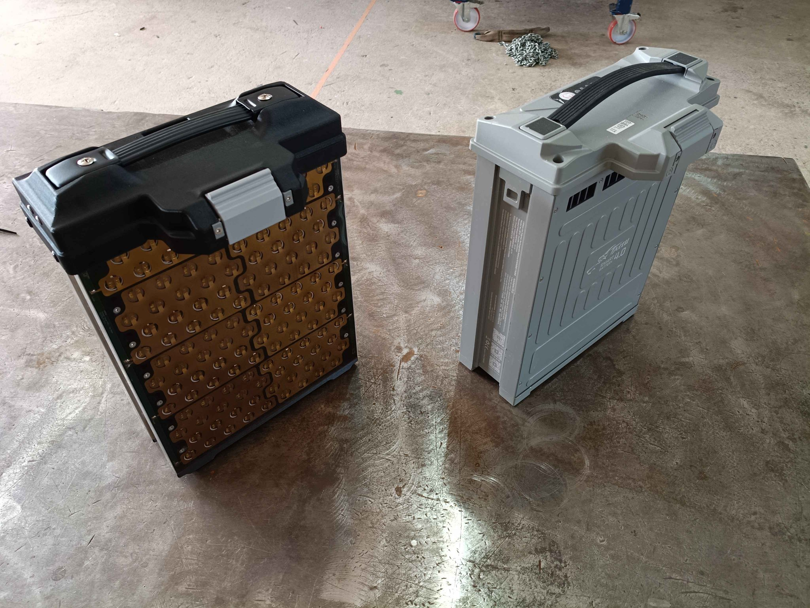

# Project Longshot

Custom 21700 Li-ion battery pack for the [Quiver](https://github.com/Arrow-air/project-quiver) drone platform.

| PT1 prototype | build123d model |
| --- | --- |
|  |  |
| The first prototype (left) next to a Tattu pack. More photos in the [PT1 build record](engineering/builds/PT1/README.md#photos). | Render of the [build123d model](engineering/cad/build123d/) of the main assembly. |

## Overview

Longshot replaces the commercial Tattu battery with a custom-built 21700 cell pack, delivering significantly more energy in the same form factor. The pack is designed for open-source tooling and compatibility with the existing Quiver power system.

## Specifications

| Parameter | Value |
|-----------|-------|
| Configuration | 14S 9P (126 cells) |
| Cell format | 21700 Li-ion |
| Energy | ~2,200–2,300 Wh |
| Voltage | 14S (~58.8V charged, ~51.8V nominal) |
| Communication | CAN H/L on main connector |
| Environmental | IP54, 4× temperature sensors |
| Structure | Printed cell holders + casing, aluminum reinforcement |
| Bus bars | Laser-cut 0.2mm copper foil |

## BMS

- **v0 (prototype):** PCB dummy — exposes cell connections, main PCB handles power path
- **v1+:** STM32-based smart BMS (VESC BMS reference design)

## Status

Project approved via [Snapshot vote](https://snapshot.box/#/s:arrowair.eth/proposal/0xe11e4b620177b6f1b65b07efa2f9be8aa85e335d46c6469106983e0b6e738772) (April 2026, amends AIP-007).

## Links

- [Proposal discussion](https://dao.arrowair.com/t/project-longshot-proposal-discussion/154)
- [Arrow DAO](https://arrowair.com)
- [Project Quiver](https://github.com/Arrow-air/project-quiver)

## License

Hardware designs (CAD files including the build123d source, schematics, PCB layouts, drawings, manufacturing files and documentation) are licensed under the **[CERN Open Hardware Licence Version 2 - Strongly Reciprocal (CERN-OHL-S v2)](LICENSE)**. The licence requires that derivative works remain open source under the same terms.

Source location: <https://github.com/Arrow-air/project-longshot>

See [CONTRIBUTING.md](CONTRIBUTING.md) for contribution guidelines.
