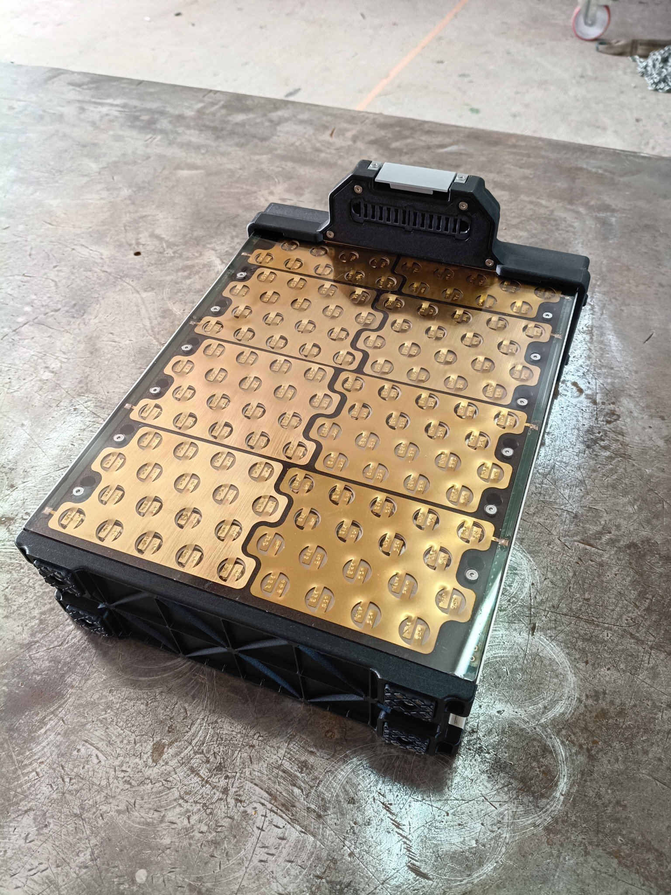
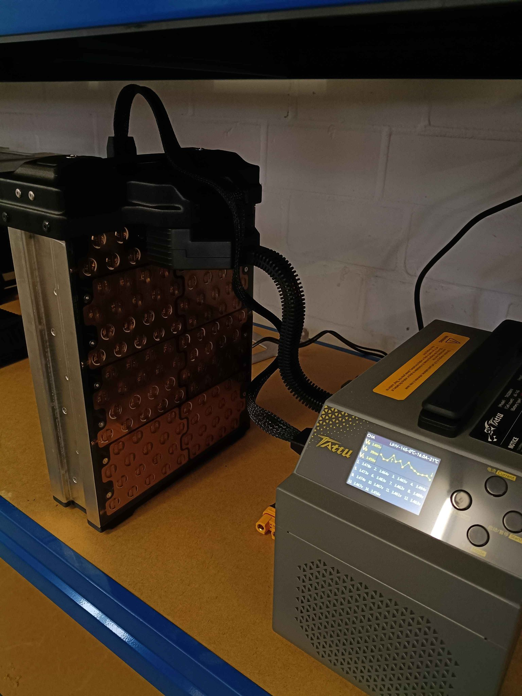
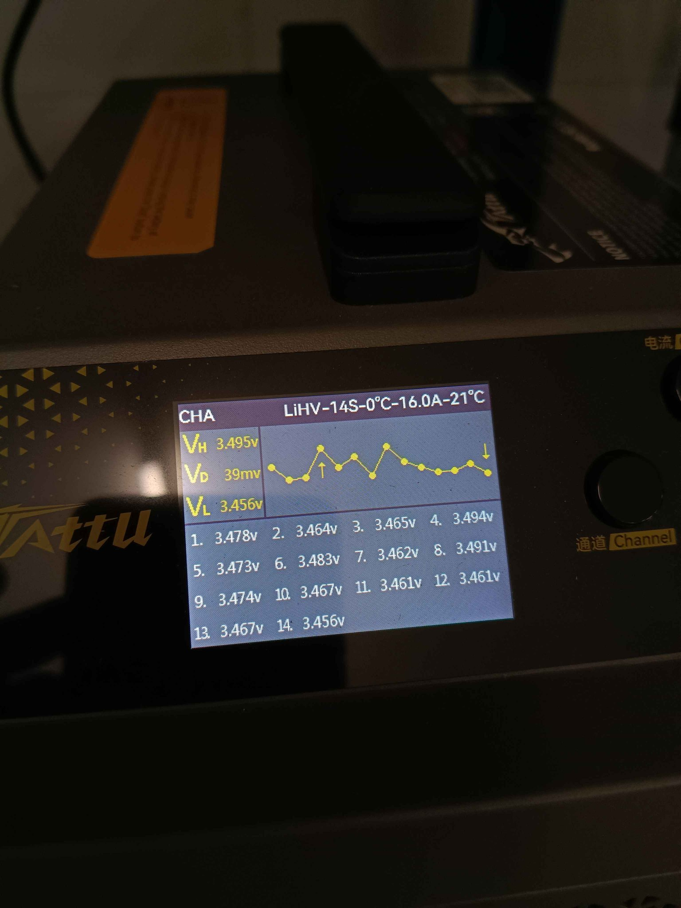
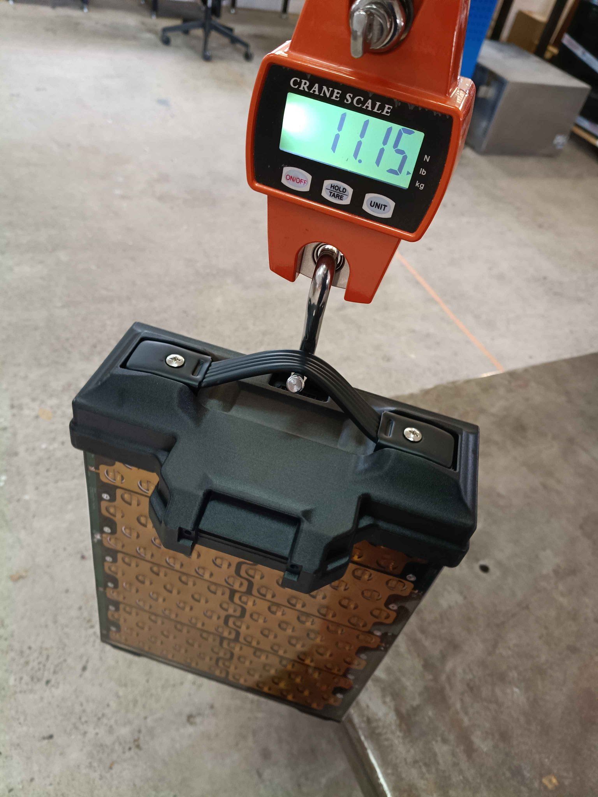
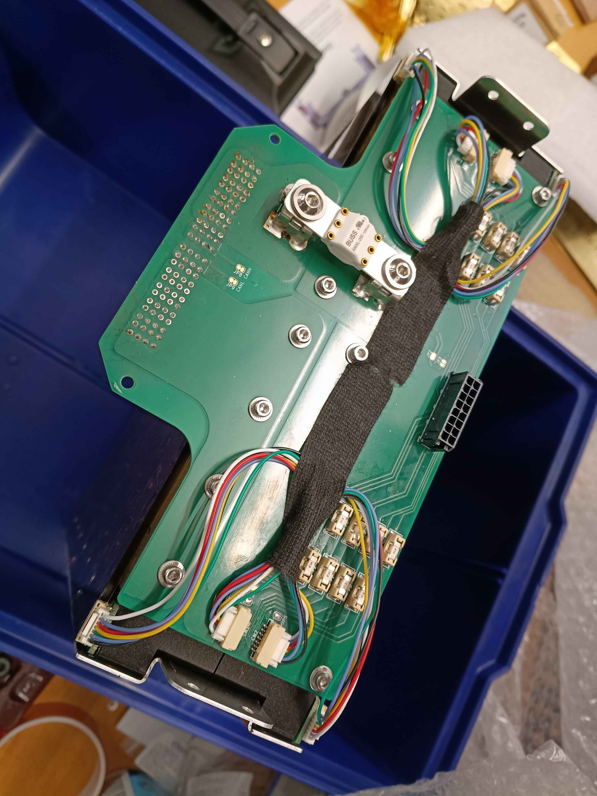

# Longshot PT1 Build

This directory records design and manufacturing artifacts that are locked or used for the Longshot PT1 build.

## Build records

- [`BOM.md`](BOM.md) — PT1 bill-of-materials and cost notes for ordered cells and copper busbars.

## Design artifacts

- [`design/copper-busbars/order-copper-longshot-pt1/`](design/copper-busbars/order-copper-longshot-pt1/) — locked copper busbar DXF order set received from Julius on 2026-06-11.

## Photos

Photos of the finished PT1 pack, taken by Julius on 2026-08-29 when the first prototype was completed.

| | |
| --- | --- |
|  |  |
| PT1 (left) next to a Tattu pack. | Copper busbars on the cell stack, seen through the PC plate. |
|  |  |
| PT1 connected to a Tattu charger. | Charger screen during charging: 14S, 16.0 A, cell voltages 3.456–3.495 V (39 mV spread). |
|  |  |
| PT1 on a crane scale: 11.15 kg. | SL_PCB on top of the pack, with the main fuse and balance wiring. |

## Change policy

Files in this build directory are build-record artifacts. If PT1 hardware changes after an order is placed, add a new clearly named revision directory and document the change instead of overwriting the locked order set.
