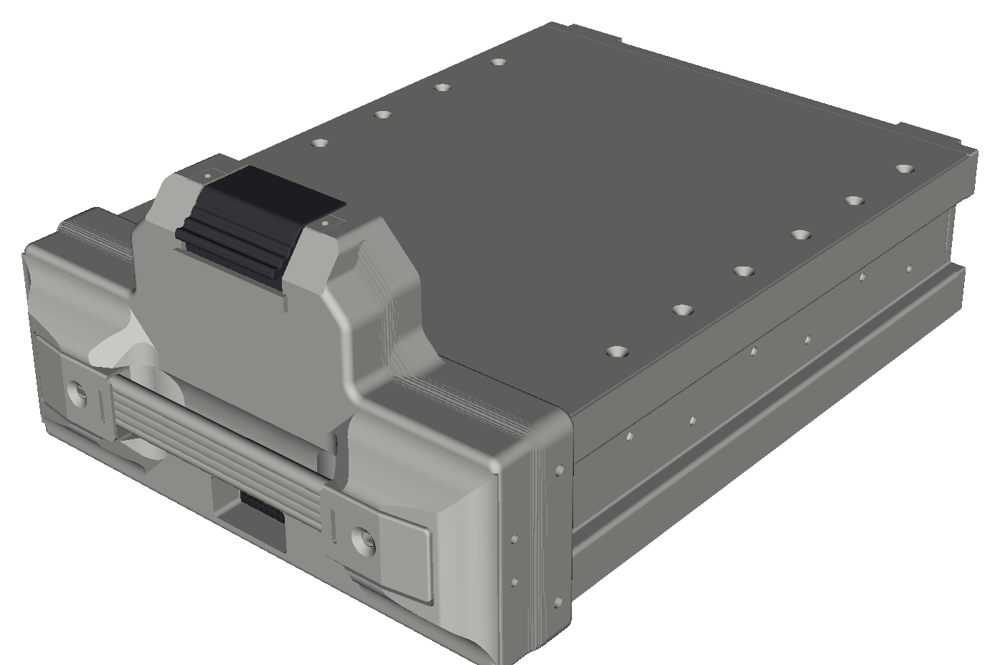
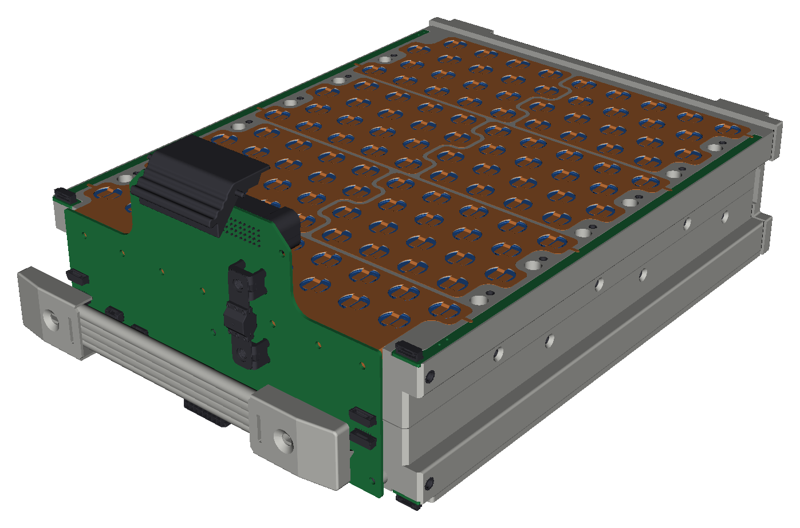

# build123d CAD

Python/[build123d](https://github.com/gumyr/build123d) model of the Longshot battery pack (14S9P, 126 × 21700 cells). It rebuilds Julius's Fusion 360 main assembly: custom parts are parametric build123d code, and purchased or PCB-derived parts load reference geometry taken from the Fusion export.

| Assembled | Top cover, top plate and side sheets hidden |
| --- | --- |
|  |  |

## Source model

Everything here is derived from Julius's Fusion 360 export `Longshot_Main_Assembly.step`, shared in `#project-longshot-general` on 2026-09-29 (STEP AP214, 47 MB). The STEP itself is not committed because of its size. Its SHA-256 and assembly bounding box are recorded in [`src/longshot/placements.json`](src/longshot/placements.json).

## What's here

| Path | Contents |
| --- | --- |
| [`src/longshot/parts/`](src/longshot/parts/) | One parametric module per custom part number (cells, busbars, cell holders, plates, sheets, printed parts, strap). Key dimensions are module-level constants probed from the Fusion solids. |
| [`src/longshot/cots/`](src/longshot/cots/) | Wrapper modules for purchased and PCB parts (inserts, connectors, fuses, PCBs, Tattu clip). They load reference geometry and do not recreate it. |
| [`src/longshot/assembly.py`](src/longshot/assembly.py) | Rebuilds the full Fusion tree as a labelled build123d compound and exports STEP/STL. |
| [`src/longshot/placements.json`](src/longshot/placements.json) | Fusion assembly tree, every item and leaf instance with its global 4×4 location, and reference metrics per part. |
| [`src/longshot/catalog.py`](src/longshot/catalog.py) | BOM descriptions, categories, make/buy and materials. |
| [`reference/cots/`](reference/cots/) | Gzip-compressed reference STEPs for purchased/PCB parts, in their own component frame. |
| [`exports/step/`](exports/step/), [`exports/stl/`](exports/stl/) | Per-part STEP and STL exports of every custom part, generated from the build123d code. |
| [`validation/results.md`](validation/results.md) | Per-part comparison of the build123d parts against the Fusion solids. |
| [`BOM.md`](BOM.md), [`BOM.csv`](BOM.csv) | Bill of materials for one pack, counted from the Fusion tree. Purchase records and costs stay in the [PT1 BOM](../../builds/PT1/BOM.md). |
| [`tools/`](tools/) | Scripts to extract references, validate parts, generate the BOM and render the preview. |

Each part module has a `PART_NUMBER`, its parameters, and a `build()` function. `build()` returns the part in the Fusion component frame, so the placements in `placements.json` apply directly. Modules are named after the part number in lower case, for example `PW-BUS-003-Bridge_1` is `parts/pw_bus_003_bridge_1.py`.

## Setup

Use Python 3.11 or newer. Run all commands from `engineering/cad/build123d/`.

```sh
python3 -m venv .venv
. .venv/bin/activate
pip install -r requirements.txt   # build123d, plus vtk and pillow for the preview
```

## Commands

1. Extract placements and reference geometry from the Fusion export. This rewrites `src/longshot/placements.json` and `reference/cots/`, and writes the custom-part reference solids to `reference/.cache/` (git-ignored, about 30 MB). You only need this after a new Fusion export, or before validating.

    ```sh
    python tools/extract_reference.py /path/to/Longshot_Main_Assembly.step
    ```

2. Validate every custom part against its Fusion solid. This writes `validation/results.md` and `validation/results.json`. The symmetric-difference check needs `reference/.cache/` from step 1. Without it, only the bounding box and volume are checked.

    ```sh
    python tools/validate_parts.py                      # all parts
    python tools/validate_parts.py EN-PC-001-Top_Plate  # one part
    ```

3. Build the assembly. This checks the rebuilt bounding box against the Fusion assembly (249.0 × 346.5 × 138.8 mm) and writes the per-part exports and `exports/step/Longshot_Main_Assembly.step`.

    ```sh
    PYTHONPATH=src python -m longshot.assembly             # everything
    PYTHONPATH=src python -m longshot.assembly --check     # bbox check only
    PYTHONPATH=src python -m longshot.assembly --no-step   # per-part exports only
    ```

4. Generate the BOM (`BOM.md` and `BOM.csv`) from the placements and validation results.

    ```sh
    python tools/generate_bom.py
    ```

5. Render the preview images (optional, needs `vtk` and `pillow`).

    ```sh
    python tools/render_preview.py docs/preview.png
    python tools/render_preview.py docs/preview-open.png --hide-covers
    ```

## Notes and limitations

- **Full assembly STEP is not committed.** It is about 75 MB, mostly vendor models, so it is git-ignored. Regenerate it with step 3. The per-part exports are committed.
- **Cell:** Fusion uses a vendor model named "Molicel 21700 P45B" as a placeholder. The build123d cell is a simplified parametric can, insulator ring and cap with the same outer dimensions (Ø21.55 × 70.15 mm). PT1 uses BAK 21700 65E cells; see the [PT1 BOM](../../builds/PT1/BOM.md).
- **PCB artwork:** the SL_PCB copper layer (about 18 MB as STEP) and all silkscreen layers are not in `reference/cots/`. The assembly leaves them out. Board outlines, pads, soldermask and all components are included.
- **Part-number spelling:** `EN-SHEET-001-Reinfocement_Right` and `EN-SHEET-002-Reinfocement_Left` keep the CAD spelling so they match Fusion.
- **Validation:** pass criteria are a bounding-box delta of 0.2 mm or less, a volume delta within ±1 %, and a symmetric difference under 2 % of the part volume. See [`validation/results.md`](validation/results.md) for the measured numbers and the notes on any part that does not pass.
